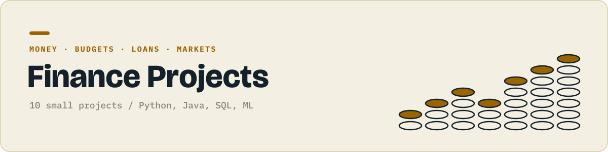

<p align="center"></p>

<p align="center">
  
  
</p>

Personal and corporate finance tools, from calculators to a first classifier.

Each folder is one small, self contained project that does one thing. They get harder as the numbers go up: first scripts, then data and charts, then Java, SQL and APIs, then a first machine learning model.

## Projects

| # | Project | What it does | Language | Status |
|:-:|---|---|:-:|:-:|
| 01 | Loan EMI calculator | Works out the monthly payment on a loan. |  | 🔜 |
| 02 | Budget tracker CLI | Logs income and spending and shows what is left. |  | ⬜ |
| 03 | Currency converter | Converts currencies with live rates from a free API. |  | ⬜ |
| 04 | Savings goal planner | Shows how many weeks it takes to reach a savings target. |  | ⬜ |
| 05 | Expense CSV analysis | Breaks spending down by category with a chart. |  | ⬜ |
| 06 | India vs US inflation | Charts inflation for both countries from the World Bank API. |  | ⬜ |
| 07 | Stock portfolio tracker | Tracks holdings and total value using classes. |  | ⬜ |
| 08 | SQL on a sales database | Answers revenue questions on the Chinook sample database. |  | ⬜ |
| 09 | Bank statement categoriser | Tags each transaction with a category using simple rules. |  | ⬜ |
| 10 | Loan approval classifier | Predicts whether a loan gets approved. |  | ⬜ |

✅ done &nbsp; 🔜 up next &nbsp; ⬜ planned

## Running a project

```bash
git clone https://github.com/JilkaTeerth/finance-projects.git
cd finance-projects/01-...
```

Every folder has its own README with the exact commands. Python projects need `pip install -r requirements.txt`, Java projects compile with plain `javac`.

---

<sub>Part of a series of six project collections. See them all at [github.com/JilkaTeerth](https://github.com/JilkaTeerth).</sub>
